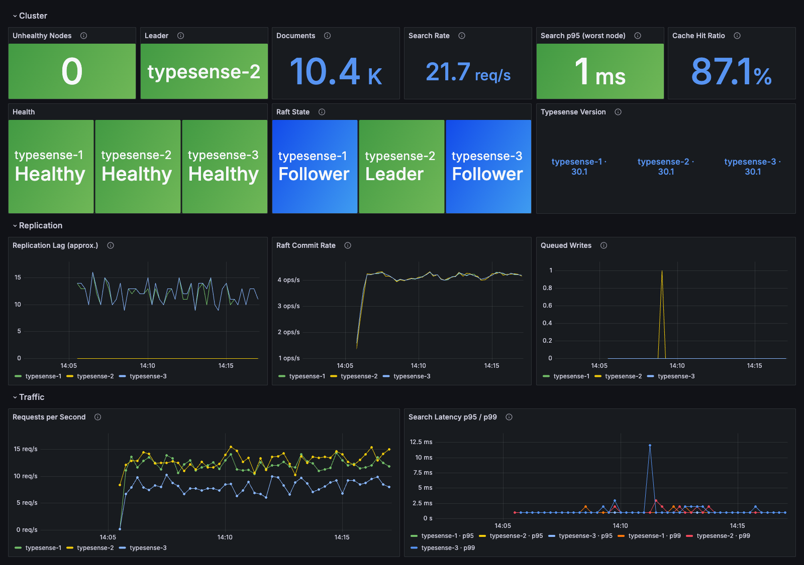
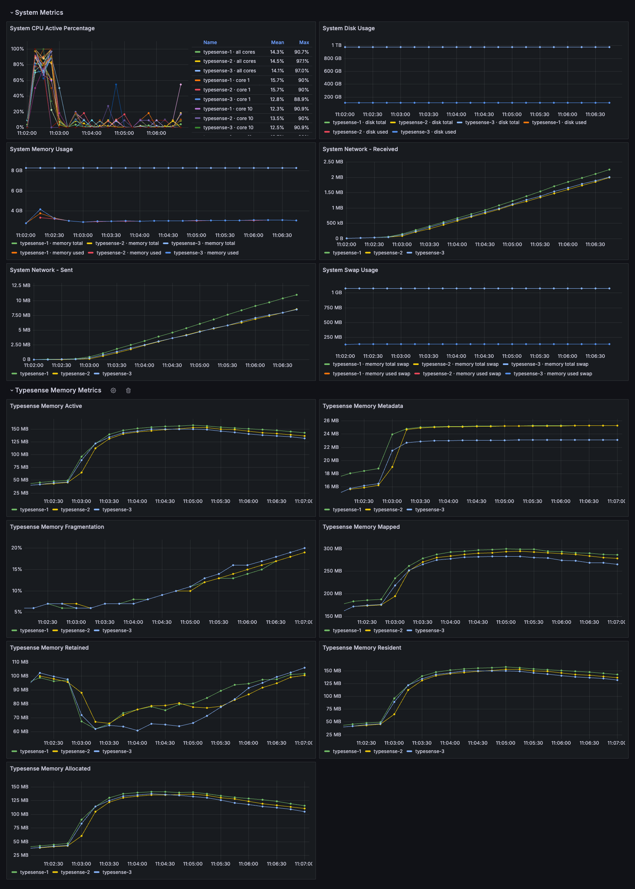
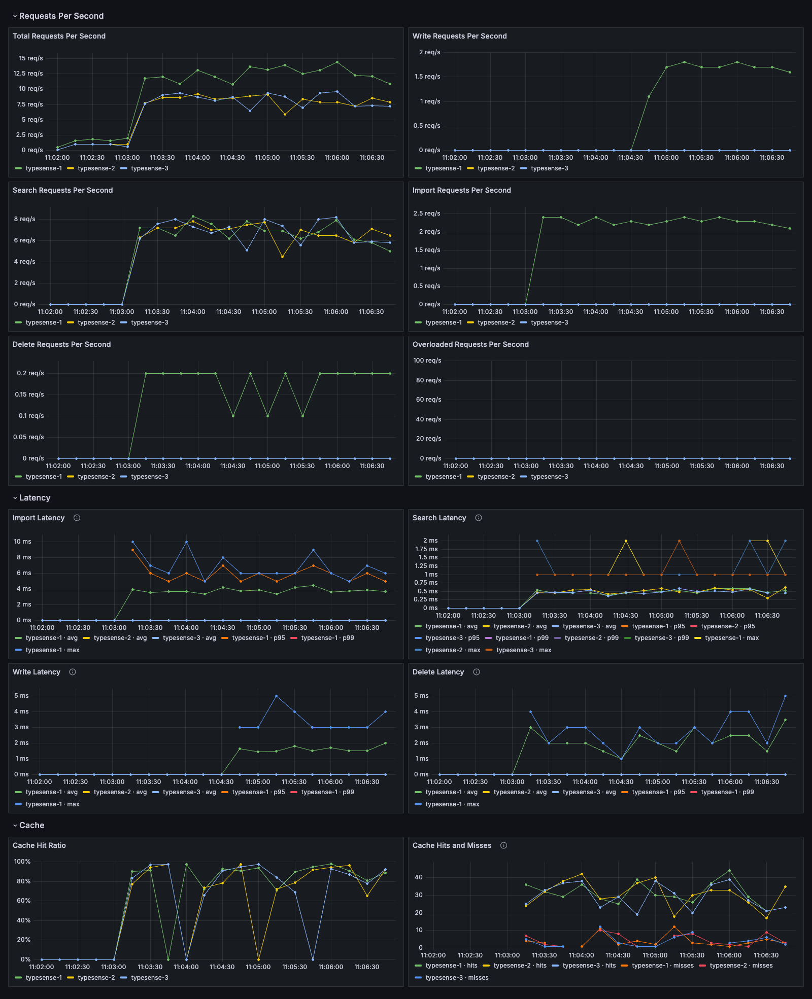
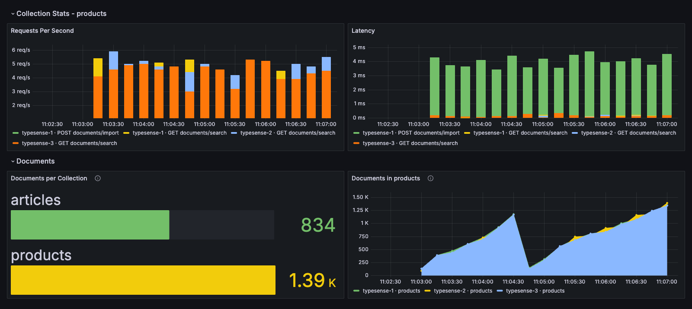

<div align="center">

# Typesense Prometheus Exporter

**Prometheus metrics, Grafana dashboards and alerts for [Typesense](https://typesense.org): single nodes and HA clusters.**

[](https://github.com/imatefx/typesense-prometheus-exporter/actions/workflows/ci.yml)
[](https://github.com/imatefx/typesense-prometheus-exporter/actions/workflows/rust.yml)
[](docs/testing.md#coverage)
[](LICENSE)
<br>
[](https://hub.docker.com/r/imatefx/typesense-prometheus-exporter)
[](https://hub.docker.com/r/imatefx/typesense-prometheus-exporter)
[](https://hub.docker.com/r/imatefx/typesense-prometheus-exporter/tags)
[](https://hub.docker.com/r/imatefx/typesense-prometheus-exporter/tags)
[](https://typesense.org)

[Getting started](docs/getting-started.md) ·
[Configuration](docs/configuration.md) ·
[Metrics](docs/metrics.md) ·
[Architecture](docs/architecture.md) ·
[Testing](docs/testing.md) ·
[Changelog](CHANGELOG.md)



</div>

## Features

| | |
|---|---|
| 🩺 **Health and cluster state** | `typesense_health` and `typesense_raft_state` per node. Alert on an unhealthy node, or on a cluster that has lost its leader. |
| 📊 **System and memory** | CPU for every core, disk, memory, swap, network, and Typesense's allocator memory. |
| ⚡ **Request stats** | Requests per second, and latency for search, write, import and delete: average, p70, p95, p99, min and max. Broken down per endpoint and per collection, plus cache hits and misses and pending write batches. |
| 🔁 **Replication and collections** | Raft committed index and queued writes per node, so you can see replication lag. Document count per collection. Typesense version per node. |
| 🎯 **Honest failures** | If Typesense can't be reached, its metrics are left out, never faked as zeros. A per-request timeout keeps a hung node from stalling scrapes. |
| 📦 **Tiny image** | A static binary in a `FROM scratch` image, for linux/amd64 and linux/arm64. |
| 🧰 **Batteries included** | 4 Grafana dashboards, Prometheus alert rules, and a one-command Docker Compose cluster for trying it all out. |

## Quick start

**See it working in one command.** This starts a 3-node Typesense cluster, an exporter per node, and Prometheus and Grafana:

```bash
docker compose up -d --build
./scripts/traffic.sh 300          # optional: generate traffic
open http://localhost:3000        # Grafana: admin / admin
```

**Monitor your own Typesense.** Run one exporter per node:

```bash
docker run -d -p 8888:8888 \
  -e TYPESENSE_HOST=typesense-1.internal \
  -e TYPESENSE_API_KEY=<admin-api-key> \
  imatefx/typesense-prometheus-exporter:v0.4.1

curl -s localhost:8888/metrics | grep -E '^typesense_(health|raft_state)'
```

Then add the exporters to Prometheus, and import the [dashboards](grafana/) and [alert rules](deploy/prometheus/alerts.yml). The [getting started guide](docs/getting-started.md) walks through it.

## Configuration

| Flag | Environment variable | Default |
|---|---|---|
| `--typesense-host` | `TYPESENSE_HOST` | *(required)* |
| `--typesense-api-key` / `--typesense-api-key-file` | `TYPESENSE_API_KEY` / `TYPESENSE_API_KEY_FILE` | *(one is required)* |
| `--typesense-port` | `TYPESENSE_PORT` | `8108` |
| `--typesense-protocol` | `TYPESENSE_PROTOCOL` | `http` |
| `--typesense-timeout` | `TYPESENSE_TIMEOUT` | `5` seconds (`0` disables); keep it below Prometheus' `scrape_timeout` |
| `--exporter-bind-address` | `EXPORTER_BIND_ADDRESS` | `0.0.0.0` |
| `--exporter-bind-port` | `EXPORTER_BIND_PORT` | `8888` |

See [configuration](docs/configuration.md) for API key permissions, timeouts, failure behaviour, Prometheus and Grafana setup.

## Metrics at a glance

| Metric | What it tells you |
|---|---|
| `typesense_health` | 1 healthy, 0 unhealthy or unreachable |
| `typesense_raft_state` | 1 leader, 4 follower, 0 other or unreachable |
| `typesense_raft_committed_index` | Raft log position; compare across nodes for replication lag |
| `typesense_raft_queued_writes` | Writes waiting to be applied |
| `typesense_collection_documents{collection=…}` | Documents per collection |
| `typesense_info{version=…}` | Typesense version of each node |
| `typesense_scrape_success{endpoint=…}` | Whether each Typesense endpoint could be read, for spotting key or version problems |
| `typesense_metrics{key=…}` | CPU (per core), disk, memory, swap, network, allocator memory |
| `typesense_stats{key=…}` | Every numeric `/stats.json` field: requests per second, latency avg/p70/p95/p99/min/max, pending writes, cache hits/misses/ratio |
| `typesense_stats_*_by_collection` | Requests per second and latency per collection and action |

See the [metrics reference](docs/metrics.md) for every key, with example PromQL.

## Alerts

| Alert | Fires when |
|---|---|
| `TypesenseExporterDown` | Prometheus can't scrape an exporter for 1m |
| `TypesenseUnhealthy` | A node is unhealthy or unreachable for 1m |
| `TypesenseNoLeader` | No node is raft leader for 1m. A normal election (a few seconds) doesn't trigger it. |
| `TypesenseScrapeFailing` | A healthy node has an endpoint the exporter can't read for 5m (API key permissions, older Typesense) |

## Dashboards

Four dashboards, each with a **Node** filter.

<details>
<summary><b>Typesense Cluster Overview</b>: health, leader, versions, replication lag, documents, headline traffic</summary>


</details>

<details>
<summary><b>Typesense Metrics</b>: CPU per core, disk, memory, swap, network, allocator memory</summary>


</details>

<details>
<summary><b>Typesense Stats</b>: request rates, latency avg/p95/p99/max, cache</summary>


</details>

<details>
<summary><b>Typesense By Collection</b>: per-collection request rate, latency and documents</summary>


</details>

The screenshots were taken from the bundled Docker Compose stack: 3 nodes under generated traffic.

## Development

```bash
make test         # lint + unit + integration tests
make coverage     # coverage report (fails under 90%)
make e2e          # end-to-end tests against a real 3-node cluster (needs Docker)
make up / down    # start / stop the Docker Compose stack
./build-cross.sh  # static linux/amd64 + linux/arm64 binaries
```

There are 56 tests in three layers. **Unit** and **integration** tests run against a mock Typesense. **End-to-end** tests run against a real cluster and break it on purpose: leader failover, a hung node, quorum loss. See [testing](docs/testing.md) for the full list.

## Contributors

Thanks to everyone who has contributed:

<table>
  <tr>
    <td align="center"><a href="https://github.com/imatefx"><br><sub><b>Stalin Pereira</b></sub></a><br><sub>Creator and maintainer</sub></td>
    <td align="center"><a href="https://github.com/leapalazzolo"><br><sub><b>Leandro</b></sub></a><br><sub>Stats protocol fix (<a href="https://github.com/imatefx/typesense-prometheus-exporter/pull/4">#4</a>)</sub></td>
    <td align="center"><a href="https://github.com/andriimredocly"><br><sub><b>Andrii Maryskevych</b></sub></a><br><sub>Multi-arch Docker (<a href="https://github.com/imatefx/typesense-prometheus-exporter/pull/10">#10</a>), health and raft (<a href="https://github.com/imatefx/typesense-prometheus-exporter/pull/13">#13</a>)</sub></td>
  </tr>
  <tr>
    <td align="center"><a href="https://github.com/weriomat"><br><sub><b>weriomat</b></sub></a><br><sub>Optional CPU metrics (<a href="https://github.com/imatefx/typesense-prometheus-exporter/pull/11">#11</a>)</sub></td>
    <td align="center"><a href="https://github.com/scaldarola"><br><sub><b>Sebastian Caldarola</b></sub></a><br><sub>Multi-host proposal (<a href="https://github.com/imatefx/typesense-prometheus-exporter/pull/14">#14</a>)</sub></td>
    <td align="center"><a href="https://github.com/cyppe"><br><sub><b>cyppe</b></sub></a><br><sub>Per-core CPU, swap, cache ratio (<a href="https://github.com/imatefx/typesense-prometheus-exporter/pull/15">#15</a>)</sub></td>
  </tr>
</table>

## License

[MIT](LICENSE) © Stalin Pereira
