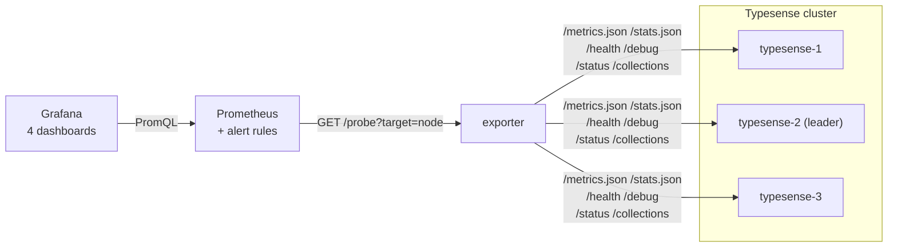
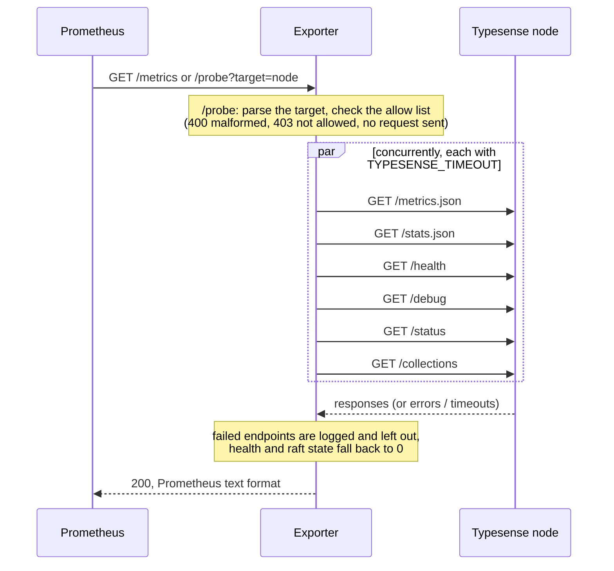
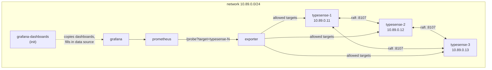

# Architecture

## Overview

The exporter is a small HTTP service. Each time Prometheus scrapes `/metrics` (the node set with `--typesense-host`) or `/probe?target=<node>` (any allowed node), the exporter queries one Typesense node, turns the answers into Prometheus metrics, and returns them. It keeps nothing between scrapes except the current API key, which it re-reads when its file changes.

**One scrape is one node.** Each node reports only its own raft role, health and system resources, and only the requests it served itself, so an exporter must never sit in front of a load balancer: it would report a random node on each scrape. Either run an exporter per node and scrape `/metrics`, or run one exporter and have Prometheus scrape `/probe?target=<node>` once per node, as `blackbox_exporter` does. Both give the same output for a node, and the `host` and `port` labels always name the Typesense node.

## A scrape, step by step

1. **Fetch.** `server::scrape` calls the six Typesense endpoints concurrently with `tokio::join!`. `/metrics` calls it for the configured node; `/probe` parses the target (`target::Target`), checks it against the allow list (`target::AllowList`) and calls it for that node, with a `TypesenseClient` built per request around the one shared reqwest client. That client applies `TYPESENSE_TIMEOUT` to each request and pools connections across targets.
2. **Decide.** Each result is either kept or logged and dropped (`log_failure`). The handler builds a `Scrape` from what survived: optional metrics, stats, status and collections, a health flag, a raft state and a version.
3. **Map and render.** `prometheus_exp::generate_metrics` builds a fresh Prometheus registry for this scrape and adds a series for each value that has data, then encodes it to text. `/metrics.json` and `/stats.json` values go through a name-mapping step chosen by `--metric-names` (the `metric_names` field of `Scrape`): `export_v1_metrics` / `export_v1_stats` map each Typesense field to its 1.0 family, convert units (ms → seconds, percent → ratio) and send fields without a name to `typesense_unmapped`; `export_legacy_metrics` / `export_legacy_stats` produce the 0.4 families. `both` runs both. The other families are added once, whatever the mode.

A fresh registry on every scrape means a metric that disappears from Typesense also disappears from the exporter. Nothing stale is left behind.

## Code layout

| Module | Responsibility |
|---|---|
| `src/main.rs` | Entry point: logging setup, parse CLI, `server::run` |
| `src/cli.rs` | `CliArgs`: flags and environment variables (clap), including `MetricNames` (`v1`, `both`, `legacy`) |
| `src/server.rs` | axum router (`/`, `/metrics`, `/probe`), the shared `scrape`, the one HTTP client, graceful shutdown |
| `src/config.rs` | `--config`: the TOML file, its option names and the flag > environment > file > default merge |
| `src/probe_config.rs` | `[clusters.<name>]`: validation, key loading and node-to-cluster lookup |
| `src/target.rs` | `Target`: strict parsing of `/probe` targets (IPv6, default scheme and port, no paths or credentials); `AllowList`: the nodes `/probe` may contact |
| `src/key.rs` | `KeySource`: an API key that is fixed (flag, environment) or follows a key file, re-reading it when its modified time or length changes (checked at most once a second, per file) |
| `src/typesense/mod.rs` | `TypesenseClient`: a shared HTTP client, base URL, `KeySource`; one method per endpoint |
| `src/typesense/models/` | serde models for the six endpoint responses. For the 1.0 names, `TypesenseMetrics::fixed_entries()` gives the fixed `/metrics.json` fields and `core_number()` picks the core out of a per-core CPU key; the 1.0 mapping reads the remaining fields (per-core values and unmapped ones) from `other` directly. `TypesenseMetrics::entries()` gives the `(key, value)` pairs for the 0.4 output. `TypesenseStats::entries()` gives every numeric `/stats.json` field and feeds both name sets |
| `src/prometheus_exp.rs` | `Scrape`, plus rendering to Prometheus text: the 1.0 and 0.4 name mappings, unit conversion, per-collection parsing, label handling |
| `src/lib.rs` | Exposes the modules so integration and e2e tests can build the real router |

## Design decisions

**Omit, don't zero.** A metric Typesense didn't provide (an endpoint failed, a field is missing, an old version) is left out of the scrape rather than exported as 0. A fake 0 looks like real data: "0 bytes of memory used", "0% cache hits". A missing series is something Prometheus and Grafana can detect and show as missing.

**Health and raft state are always present.** They are the exception to the rule above. When a node is unreachable, the useful answer is `typesense_health 0` and `typesense_raft_state 0`, because alerts are built on them.

**`/metrics` and `/probe` return 200 when Typesense is down.** Typesense failures are reported in the metrics, not as an HTTP error. `up == 0` is kept for "the exporter itself is down" (or, for `/probe`, "the target was refused", which is a 403 or 400).

**`/probe` only contacts allowed nodes.** The exporter sends its API key to the node it scrapes, so an open `/probe` would leak the key and allow SSRF. A target must belong to a configured cluster, or match `--probe-allowed-targets` (or the configured `--typesense-host`), on lowercase host and port before any request is made; `*` opts out. A cluster's node is always scraped with that cluster's key and protocol and each node has exactly one home (checked at startup), so a key cannot reach another cluster's nodes, even with `*`. Prometheus lists the nodes, and the exporter doesn't discover them, because Typesense has no API for cluster peers.

**Keys follow their file.** A `KeySource` holds the key and the file's modified time and length behind a mutex, and `TypesenseClient` asks it for the current key on every request. The first request after a second has passed checks the file's metadata (following symlinks, so a Kubernetes `..data` swap is seen) and re-reads the file only if it changed. This polls on use, so there is no watcher thread or extra dependency, and the lock is held only for a `stat`. A file that turns out unreadable or empty leaves the previous key in place, warns once, and is tried again when it changes. A key from a flag or environment variable is a fixed `KeySource`.

**Timeout below the scrape timeout.** A hung Typesense node must not hold the response past Prometheus' scrape timeout, or the whole scrape is lost and the problem shows up as the wrong alert. See [configuration](configuration.md#timeouts).

**Export every numeric stat.** `/stats.json` keeps gaining fields (latency percentiles and min/max, cache counters). The model captures all top-level fields and exports every numeric one, so new Typesense versions need no exporter change. With the 1.0 names, a field without a mapping is exported as `typesense_unmapped{source,key}` with its raw value until it gets a proper name.

**Names carry the unit, in base units.** Since 1.0.0, each value has its own family with the unit as a suffix (`_seconds`, `_bytes`, `_ratio`, counters `_total`), operations and quantiles are labels, and network bytes are counters. Unit conversion happens at export time; the models keep Typesense's raw values. See the [design note](metrics-v1.md).

**Bounded labels.** Typesense's per-endpoint stats include document and other resource IDs in the path. Exported as-is, every document read by ID would create new series. Endpoints are normalised to `…/documents/:id` before export, and the by-collection metrics don't repeat the raw endpoint, so the number of series depends on collections and routes, not on data.

**Visible partial failures.** Each scrape reports `typesense_scrape_success` per endpoint and the scrape duration. A wrong API key or an endpoint missing on an older Typesense is then something you can alert on, not just a log line.

**Per-core CPU by pattern.** `/metrics.json` has one `system_cpuN_active_percentage` key per core. The model captures unknown keys with `#[serde(flatten)]` and exports those matching `system_cpu<digits>_active_percentage`, so any core count works.

**Per-collection metrics from endpoint keys.** `/stats.json` reports latency and request rate keyed by endpoint, e.g. `GET /collections/products/documents/search`. A regex splits collection endpoints into `method`, `collection` and `action` labels (`collection_name` in the 0.4 names). The full route is exported separately as `typesense_route_*{route}`.

## Docker Compose stack

- **Nodes peer by fixed IP.** [`deploy/typesense/nodes`](../deploy/typesense/nodes) lists the nodes by IP, not hostname. Docker removes a stopped container's DNS name and may give a restarted container a new IP. Either one stops a restarting node from finding its peers, so it stays unhealthy. The e2e suite stops and restarts nodes repeatedly to make sure the cluster always re-forms.
- **Dashboards are provisioned unchanged.** The dashboards in `grafana/` are written for manual import, with a `${DS_PROMETHEUS}` data source placeholder. Grafana's provisioning doesn't fill that in, so a short-lived init container copies them with the data source set.
- **Healthchecks need no extra tools.** The Typesense image has no curl, so the healthcheck uses bash's `/dev/tcp` to call `/health`. `/health` only reports ok once the node has joined a cluster with a leader, so `docker compose up --wait` returns only when the cluster is ready.

## Build and release

| Artifact | How |
|---|---|
| Docker image | Multi-stage [`Dockerfile`](../Dockerfile): Rust 1.100 on Alpine builds a static musl binary, with cached dependencies. The final image is `FROM scratch` with CA certificates, running as the unprivileged user `65534`. |
| Multi-arch image on Docker Hub | [`docker.yml`](../.github/workflows/docker.yml) runs on every version tag (`vX.Y.Z`). linux/amd64 and linux/arm64 each build on a native GitHub runner (`ubuntu-latest`, `ubuntu-24.04-arm`), with no QEMU emulation, and push by digest. A final job merges them into one multi-arch `:vX.Y.Z` / `:latest` image and attests it. Pull requests that touch the image build both architectures without pushing. |
| Static Linux binaries | [`build-cross.sh`](../build-cross.sh) runs buildx and writes `releases/*-linux-{amd64,arm64}-musl` |
| Release binaries | [`rust.yml`](../.github/workflows/rust.yml) builds Linux, macOS and Windows targets on tags and creates the GitHub release, with notes taken from `CHANGELOG.md` and a `SHA256SUMS` file |

**Releasing** is a version bump in `Cargo.toml`, a dated `CHANGELOG.md` section, and a pushed `vX.Y.Z` tag. Both workflows run from the tag. Each first runs the tests and publishes nothing if they fail.
