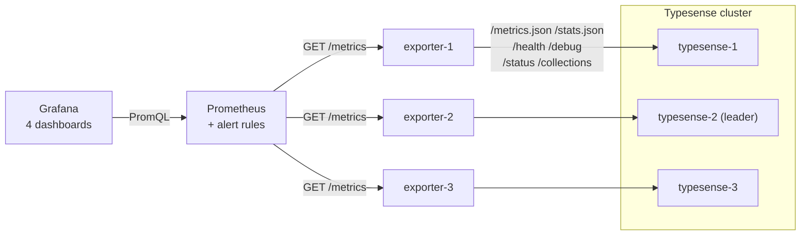
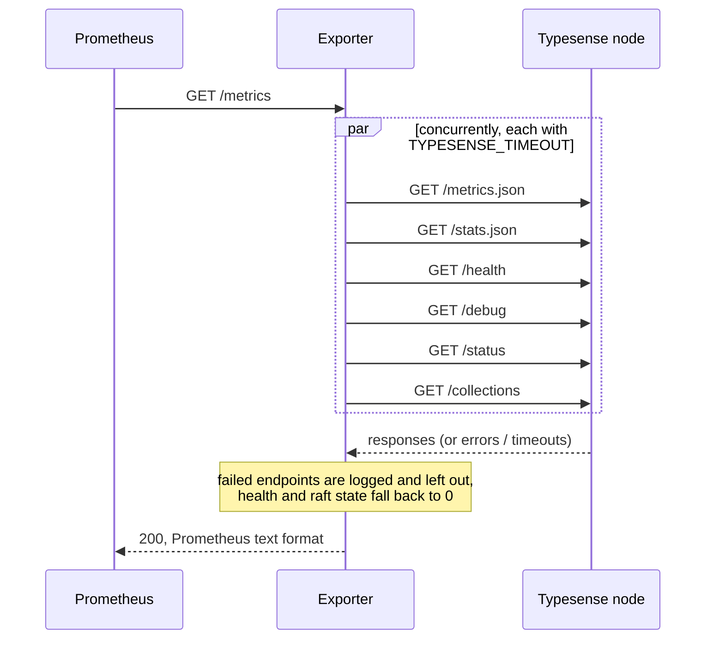
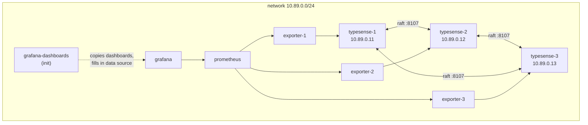

# Architecture

## Overview

The exporter is a small stateless HTTP service. Each time Prometheus scrapes `/metrics`, the exporter queries one Typesense node, turns the answers into Prometheus gauges, and returns them. It keeps nothing between scrapes.

**Run one exporter per Typesense node.** Each node reports only its own raft role, health and system resources, and only the requests it served itself. An exporter in front of a load balancer would report a random node on each scrape.

## A scrape, step by step

1. **Fetch.** `server::metrics_handler` calls the six Typesense endpoints concurrently with `tokio::join!`. They share one reqwest client, which applies `TYPESENSE_TIMEOUT` to each request.
2. **Decide.** Each result is either kept or logged and dropped (`log_failure`). The handler builds a `Scrape` from what survived: optional metrics, stats, status and collections, a health flag, a raft state and a version.
3. **Render.** `prometheus_exp::generate_metrics` builds a fresh Prometheus registry for this scrape, adds a gauge for each metric that has data, and encodes it to text.

A fresh registry on every scrape means a metric that disappears from Typesense also disappears from the exporter. Nothing stale is left behind.

## Code layout

| Module | Responsibility |
|---|---|
| `src/main.rs` | Entry point: logging setup, parse CLI, `server::run` |
| `src/cli.rs` | `CliArgs`: flags and environment variables (clap) |
| `src/server.rs` | axum router (`/`, `/metrics`), scrape handler, graceful shutdown |
| `src/typesense/mod.rs` | `TypesenseClient`: one HTTP client, base URL, API key; one method per endpoint |
| `src/typesense/models/` | serde models for the six endpoint responses. `metrics` and `stats` expose `entries()`, the `(key, value)` pairs to export |
| `src/prometheus_exp.rs` | `Scrape`, plus rendering to Prometheus text: gauges, per-collection parsing, label handling |
| `src/lib.rs` | Exposes the modules so integration and e2e tests can build the real router |

## Design decisions

**Omit, don't zero.** A metric Typesense didn't provide (an endpoint failed, a field is missing, an old version) is left out of the scrape rather than exported as 0. A fake 0 looks like real data: "0 bytes of memory used", "0% cache hits". A missing series is something Prometheus and Grafana can detect and show as missing.

**Health and raft state are always present.** They are the exception to the rule above. When a node is unreachable, the useful answer is `typesense_health 0` and `typesense_raft_state 0`, because alerts are built on them.

**`/metrics` always returns 200.** Typesense failures are reported in the metrics, not as an HTTP error. `up == 0` is kept for "the exporter itself is down".

**Timeout below the scrape timeout.** A hung Typesense node must not hold the response past Prometheus' scrape timeout, or the whole scrape is lost and the problem shows up as the wrong alert. See [configuration](configuration.md#timeouts).

**Export every numeric stat.** `/stats.json` keeps gaining fields (latency percentiles and min/max, cache counters). The model captures all top-level fields and exports every numeric one, so new Typesense versions need no exporter change.

**Per-core CPU by pattern.** `/metrics.json` has one `system_cpuN_active_percentage` key per core. The model captures unknown keys with `#[serde(flatten)]` and exports those matching `system_cpu<digits>_active_percentage`, so any core count works.

**Per-collection metrics from endpoint keys.** `/stats.json` reports latency and request rate keyed by endpoint, e.g. `GET /collections/products/documents/search`. A regex splits collection endpoints into `method`, `collection_name` and `action` labels. The original endpoint string is kept as the `key` label, so series never collide.

## Docker Compose stack

- **Nodes peer by fixed IP.** [`deploy/typesense/nodes`](../deploy/typesense/nodes) lists the nodes by IP, not hostname. Docker removes a stopped container's DNS name and may give a restarted container a new IP. Either one stops a restarting node from finding its peers, so it stays unhealthy. The e2e suite stops and restarts nodes repeatedly to make sure the cluster always re-forms.
- **Dashboards are provisioned unchanged.** The dashboards in `grafana/` are written for manual import, with a `${DS_PROMETHEUS}` data source placeholder. Grafana's provisioning doesn't fill that in, so a short-lived init container copies them with the data source set.
- **Healthchecks need no extra tools.** The Typesense image has no curl, so the healthcheck uses bash's `/dev/tcp` to call `/health`. `/health` only reports ok once the node has joined a cluster with a leader, so `docker compose up --wait` returns only when the cluster is ready.

## Build and release

| Artifact | How |
|---|---|
| Docker image | Multi-stage [`Dockerfile`](../Dockerfile): Rust 1.88 on Alpine builds a static musl binary, and the final image is `FROM scratch` with CA certificates. |
| Multi-arch image on Docker Hub | [`docker.yml`](../.github/workflows/docker.yml) runs on every version tag (`vX.Y.Z`): it builds linux/amd64 + linux/arm64, pushes `:vX.Y.Z` and `:latest`, and attests the build. Pull requests that touch the image get an amd64 test build. |
| Static Linux binaries | [`build-cross.sh`](../build-cross.sh) runs buildx and writes `releases/*-linux-{amd64,arm64}-musl` |
| Release binaries | [`rust.yml`](../.github/workflows/rust.yml) builds Linux, macOS and Windows targets on tags and creates the GitHub release, with notes taken from `CHANGELOG.md` and a `SHA256SUMS` file |

**Releasing** is a version bump in `Cargo.toml`, a dated `CHANGELOG.md` section, and a pushed `vX.Y.Z` tag. Both workflows run from the tag.
